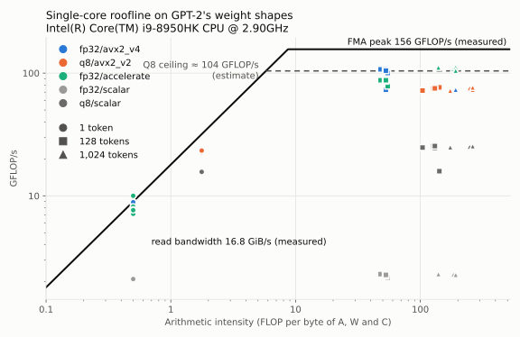

# ai-infra-minis

[](https://github.com/emmanuel-schilling/ai-infra-minis/actions/workflows/ci.yml)

Small, measured projects on how LLM inference works and where its time goes.
Each project builds one idea, tests it against a simple reference, and records
its benchmarks. Projects are added here as they start.

## Projects

| Project | What it explores | Language | Status |
|---|---|---|---|
| [Quantized matmul](projects/quant-matmul/) | Scalar, AVX2 + FMA and 8-bit quantized matrix multiply, compared with a vendor BLAS (Accelerate on macOS, OpenBLAS elsewhere) | C++20 | Complete |
| [Profile llama.cpp](projects/profile-llama-cpp/) | Where a production inference engine spends its time on the CPU, for prompt processing and for token generation | Profiling | Active |

Each project folder has a `STATUS.md` (state, open questions, decisions and
their reasons) and a `RESULTS.md` (benchmarks and conclusions).

### Quantized matmul

On one core of an Intel i9-8950HK, with GPT-2's weight shapes:

- The cache-blocked AVX2 + FMA kernel beats single-threaded Accelerate on four
  of the five shapes: by 20–28% at 128 tokens and up to 8% at 1,024.
- 8-bit (Q8_0-style) weights make decode, which reads every weight once per
  token, 2.6–2.7× faster than fp32. Prefill runs at about 0.7× of fp32:
  without VNNI, AVX2 needs 6 operations on the FMA ports per 32 int8 products
  where fp32 needs 4 FMAs (an estimate from Intel's instruction tables).
- Q8's error on GPT-2's own weights is 0.6–0.8% relative, all of it from
  quantization; the fp32 kernels stay within 1e-6.
- Open lead: the fp32 kernel slows on the MLP down projection (k = 3,072),
  most likely because its block of weights outgrows L2. The 8-bit kernel,
  whose block fits, doesn't slow there.



Details, tables and the open questions are in its
[RESULTS.md](projects/quant-matmul/RESULTS.md).

## How results are measured

- Release builds, scripted and repeatable. Each run records the hardware,
  compiler flags and exact command.
- Raw output goes in a new dated folder under the project's `results/`;
  earlier runs are never overwritten.
- Repeated runs with cooldowns, reported as medians, because the development
  laptop (Intel Core i9-8950HK, AVX2 and FMA) throttles under sustained load.
- Every optimized version is tested against a simple reference implementation
  before it is timed.

## Building and testing

The code builds and is tested on Linux, macOS and Windows. CI runs the steps
below on all three.

Requirements:
- CMake 4.0 or later, Ninja and a C++20 compiler
- [vcpkg](https://vcpkg.io/), with `VCPKG_ROOT` set to its checkout; it
  installs GoogleTest, Google Benchmark and, on Linux and Windows, OpenBLAS,
  at the versions pinned in `vcpkg.json`
- [uv](https://docs.astral.sh/uv/) for the Python tools

```sh
# C++: debug build with AddressSanitizer and UndefinedBehaviorSanitizer
cmake --preset dev
cmake --build --preset dev
ctest --preset dev

# Python: format, lint, type-check and test
uv sync --locked
uv run ruff format --check .
uv run ruff check .
uv run pyright
uv run pytest
```

## Running the benchmarks

```sh
uv run python projects/quant-matmul/scripts/run_bench.py
```

This builds the `release` preset, runs the benchmarks for several rounds with
cooldowns between them, and writes the raw output, the machine and build
details, and the medians to a new dated folder under
`projects/quant-matmul/results/`.

```sh
# Place a run's benchmarks on its measured roofline (table and chart)
uv run python projects/quant-matmul/scripts/roofline.py projects/quant-matmul/results/<run>

# Accuracy against a double-precision reference, on uniform random weights and,
# once downloaded (a pinned revision, about 1 GB on disk, not committed), GPT-2's own
uv run python projects/quant-matmul/scripts/fetch_gpt2.py
uv run python projects/quant-matmul/scripts/run_accuracy.py
```

## License

[MIT](LICENSE)
