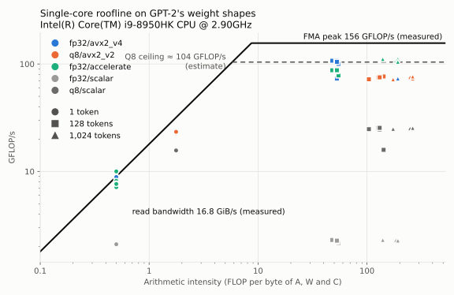

# Quantized matmul: results

Each benchmark run records the hardware, compiler flags and exact command, and
keeps its raw output in a dated folder under `results/` in this project. Never
overwrite an earlier run; add a new one and summarize it here.

A round is excluded when its results differ from round 1's by more than 5%:
the median, over all benchmarks, of the ratio of each benchmark's time in that
round to its time in round 1 (`time_vs_round_1` and `slow_rounds` in
`metadata.json`). Runs up to 2026-11-12 used an earlier rule, comparing a
short speed check before and after each round with the run's first check, and
keep the verdicts that rule gave; the check is still recorded as a diagnostic.
A run with an excluded round is invalid. Invalid runs are
kept, with an `INVALID.md` that gives the reason, and are never summarized.

## Roofline (2026-11-13 run)

Every benchmark of the 2026-11-13 run below, placed on that run's measured
ceilings with `scripts/roofline.py`: peak FMA 156.2 GFLOP/s and read bandwidth
16.75 GiB/s, so the ridge point is at 8.7 FLOP/byte. Intensity counts A, W and
C read or written once (W at 36 bytes per 32 weights for Q8). The full table
is `results/2026-11-14_i9-8950hk/roofline.md`.

Share of the roofline's ceiling reached, over the benchmarked shapes:

| Kernel | GEMV (1 token) | GEMM (128 and 1,024 tokens) | GEMM, of the Q8 estimate |
|---|---|---|---|
| fp32/scalar | 23–24% | 1% | |
| fp32/avx2_v1 | 96–100% | 6–14% | |
| fp32/avx2_v2 | 100–105% | 6–19% | |
| fp32/avx2_v3 | 96–100% | 13–55% | |
| fp32/avx2_v4 | 96–99% | 47–72% | |
| fp32/accelerate | 79–111% | 50–71% | |
| q8/scalar | 48–49% | 10–16% | 15–24% |
| q8/avx2_v1 | 72–74% | 15–32% | 23–48% |
| q8/avx2_v2 | 72–74% | 46–49% | 69–73% |

GEMV sits at 0.5 FLOP/byte for fp32 and 1.8 for Q8, both left of the ridge,
so its ceiling is the bandwidth; GEMM sits at 47–270 FLOP/byte, so its ceiling
is the peak. The Q8 estimate is 4/6 of the peak (about 104 GFLOP/s, see the
conclusions), an estimate from instruction tables, not a measurement. Shares
above 100% mean the read-bandwidth benchmark slightly understates what the
memory system delivers.

## Accuracy (2026-11-13)

Run `results/2026-11-14_i9-8950hk_accuracy/` (dated in UTC), with
`uv run python projects/quant-matmul/scripts/run_accuracy.py`: every kernel at
128 tokens, against a double-precision product of the same fp32 A and W. The
Q8 kernels quantize W ahead of time and A inside the call, so their error
includes both quantizations. A is uniform random in [-1, 1) throughout; W is
either uniform random (as in the benchmarks) or GPT-2's own matrices, from
`openai-community/gpt2` revision `607a30d` (`scripts/fetch_gpt2.py`), all 12
layers, with the token embedding as lm_head. The source was commit `f3a5784`
plus uncommitted changes, saved as `source.patch` in the run folder.
`summary.md` there also has the maximum absolute errors.

Relative error ‖C − C_ref‖ / ‖C_ref‖, uniform random W:

| Shape | fp32 scalar | v1 | v2 | v3 | v4 | Accelerate | Q8 scalar | Q8 v1 | Q8 v2 |
|---|---|---|---|---|---|---|---|---|---|
| k = 768 (attn_qkv, attn_out, mlp_up, lm_head) | 5.0e-7 | 1.8e-7 | 9.3e-8 | 1.8e-7 | 1.8e-7 | 1.8e-7 | 5.3e-3 | 5.3e-3 | 5.3e-3 |
| k = 3,072 (mlp_down) | 9.9e-7 | 3.5e-7 | 1.4e-7 | 3.5e-7 | 3.5e-7 | 1.9e-7 | 5.3e-3 | 5.3e-3 | 5.3e-3 |

Relative error, GPT-2's W, the worst of its 12 layers:

| Shape | fp32 scalar | v1 | v2 | v3 | v4 | Accelerate | Q8 scalar | Q8 v1 | Q8 v2 |
|---|---|---|---|---|---|---|---|---|---|
| attn_qkv | 5.0e-7 | 1.8e-7 | 9.3e-8 | 1.8e-7 | 1.8e-7 | 1.8e-7 | 6.9e-3 | 6.9e-3 | 6.9e-3 |
| attn_out | 5.1e-7 | 1.9e-7 | 9.4e-8 | 1.9e-7 | 1.9e-7 | 1.9e-7 | 6.8e-3 | 6.8e-3 | 6.8e-3 |
| mlp_up | 5.0e-7 | 1.8e-7 | 9.3e-8 | 1.8e-7 | 1.8e-7 | 1.8e-7 | 6.9e-3 | 6.9e-3 | 6.9e-3 |
| mlp_down | 1.0e-6 | 3.6e-7 | 1.4e-7 | 3.6e-7 | 3.6e-7 | 1.9e-7 | 7.6e-3 | 7.6e-3 | 7.6e-3 |
| lm_head (embedding) | 5.0e-7 | 1.8e-7 | 9.4e-8 | 1.8e-7 | 1.8e-7 | 1.8e-7 | 6.8e-3 | 6.8e-3 | 6.8e-3 |

## Benchmarks

### Q8: scalar, AVX2 v1 and v2, against fp32 (2026-11-13)
Run `results/2026-11-14_i9-8950hk/` (the folder is dated in UTC; it ran on the
evening of 2026-11-13 local time): 3 rounds × 5 repetitions, all valid (no
throttling; rounds 2 and 3 took 1.004 and 1.000 times round 1's time). The
speed check before round 2 was 6.6% faster than the run's first check (65.3
against 69.9 ms); under the current rule that is a diagnostic only.

- Hardware: as on 2026-11-11 below.
- Software: macOS 15.8.3, Apple clang 17.0.0, Release (`-O3 -DNDEBUG
  -std=c++20`; the AVX2 files add `-mavx2 -mfma`).
- Source: commit `cc0e71e`, no uncommitted changes. `matmul_avx2` calls v4;
  `matmul_q8_avx2` calls Q8 v1, and Q8 v2 is benchmarked as its own step.
- Command: `uv run python projects/quant-matmul/scripts/run_bench.py`.
- Measured ceilings: peak FMA 156 GFLOP/s, read bandwidth 16.8 GiB/s.

Q8 kernels quantize A inside each call, so that cost is included; W is
quantized ahead of time. GFLOP/s counts 2·m·n·k for every kernel, so the
columns compare directly.

GEMM (prefill), GFLOP/s, median over 15 repetitions:

| Shape (n × k), tokens | Q8 scalar | Q8 v1 | Q8 v2 | fp32 v4 | Accelerate |
|---|---|---|---|---|---|
| attn_qkv 2,304 × 768, 128 | 25.4 | 49.6 | 74.7 | 106.9 | 87.3 |
| attn_qkv 2,304 × 768, 1,024 | 25.2 | 49.2 | 75.5 | 111.6 | 108.2 |
| attn_out 768 × 768, 128 | 24.7 | 48.5 | 72.0 | 107.2 | 87.4 |
| attn_out 768 × 768, 1,024 | 24.9 | 47.9 | 72.0 | 111.8 | 111.2 |
| mlp_up 3,072 × 768, 128 | 25.4 | 48.9 | 75.1 | 104.6 | 87.4 |
| mlp_up 3,072 × 768, 1,024 | 25.4 | 49.0 | 76.4 | 112.7 | 104.7 |
| mlp_down 768 × 3,072, 128 | 24.6 | 49.8 | 73.5 | 73.1 | 85.8 |
| mlp_down 768 × 3,072, 1,024 | 24.8 | 49.6 | 73.3 | 73.3 | 111.6 |
| lm_head 50,257 × 768, 128 | 15.9 | 23.8 | 76.5 | 100.2 | 78.2 |

GEMV (decode, 1 token): GiB/s of data read (for Q8, the 36-byte blocks), and
the speed-up of Q8 v1 in time over fp32 v4:

| Shape | Q8 scalar | Q8 v1 | Q8 v2 | fp32 v4 | Accelerate | Q8 v1 over fp32 v4 |
|---|---|---|---|---|---|---|
| attn_qkv | 8.2 | 12.3 | 12.3 | 16.6 | 14.4 | 2.63× |
| attn_out | 8.0 | 12.1 | 12.0 | 16.7 | 15.3 | 2.56× |
| mlp_up | 8.3 | 12.2 | 12.3 | 16.6 | 14.3 | 2.61× |
| mlp_down | 8.1 | 12.3 | 12.3 | 16.0 | 18.7 | 2.71× |
| lm_head | 8.3 | 12.4 | 12.4 | 16.2 | 13.3 | 2.70× |

The fp32 kernels ran again from the code that now shares `dot_fp32_rows`. Per
benchmark, the median time ratio to the 2026-11-12 run is 0.990 for v1, 0.973
for v3 and 1.001 for v4 (ranges 0.946–1.014), against 1.000 and 1.001 for
the unchanged scalar and Accelerate kernels.

### fp32: scalar, AVX2 v1 to v4, Accelerate (2026-11-12)
Run `results/2026-11-12_i9-8950hk_2/`: 3 rounds × 5 repetitions, all valid (no
throttling; speed checks 66.0–68.9 ms, within 4.2% of the first). Over all
benchmarks, the median time in rounds 2 and 3 is within 1% of round 1's.

- Hardware: as on 2026-11-11 below.
- Software: macOS 15.8.3 (updated since the last run), Apple clang 17.0.0,
  Release (`-O3 -DNDEBUG -std=c++20`; the AVX2 file adds `-mavx2 -mfma`).
- Source: commit `f454d55`, no uncommitted changes. `matmul_avx2` still calls
  v3; v4 is benchmarked as its own step.
- Command: `uv run python projects/quant-matmul/scripts/run_bench.py`.
- Measured ceilings: peak FMA 154 GFLOP/s, read bandwidth 16.7 GiB/s.

GEMM (prefill), GFLOP/s, median over 15 repetitions:

| Shape (n × k), tokens | scalar | v1 | v2 | v3 | v4 | Accelerate |
|---|---|---|---|---|---|---|
| attn_qkv 2,304 × 768, 128 | 2.3 | 19.8 | 25.0 | 74.7 | 106.2 | 86.6 |
| attn_qkv 2,304 × 768, 1,024 | 2.3 | 19.8 | 25.2 | 80.0 | 113.1 | 108.0 |
| attn_out 768 × 768, 128 | 2.3 | 21.7 | 29.2 | 80.9 | 107.1 | 87.0 |
| attn_out 768 × 768, 1,024 | 2.3 | 21.3 | 29.2 | 84.8 | 113.1 | 110.1 |
| mlp_up 3,072 × 768, 128 | 2.2 | 14.2 | 15.7 | 48.5 | 104.8 | 87.1 |
| mlp_up 3,072 × 768, 1,024 | 2.3 | 14.2 | 15.7 | 51.7 | 112.3 | 105.7 |
| mlp_down 768 × 3,072, 128 | 2.2 | 14.3 | 15.7 | 55.7 | 72.5 | 87.4 |
| mlp_down 768 × 3,072, 1,024 | 2.2 | 14.3 | 15.7 | 57.6 | 73.5 | 111.1 |
| lm_head 50,257 × 768, 128 | 2.2 | 8.7 | 9.1 | 20.8 | 99.4 | 80.4 |

GEMV (decode, 1 token), GiB/s of weights read:

| Shape | scalar | v1 | v2 | v3 | v4 | Accelerate |
|---|---|---|---|---|---|---|
| attn_qkv | 4.0 | 16.5 | 17.4 | 16.2 | 16.6 | 14.6 |
| attn_out | 4.0 | 16.7 | 17.5 | 16.3 | 16.6 | 15.4 |
| mlp_up | 4.0 | 16.6 | 17.4 | 16.2 | 16.6 | 14.4 |
| mlp_down | 3.9 | 16.0 | 17.3 | 16.1 | 16.1 | 18.7 |
| lm_head | 3.9 | 16.2 | 16.9 | 15.8 | 16.2 | 13.3 |

### fp32: scalar, AVX2 v1 to v3, Accelerate (2026-11-11)
Run `results/2026-11-11_i9-8950hk/`: 3 rounds × 5 repetitions, all valid (no
throttling; speed checks 66.7–69.7 ms, within 3% of the first).

- Hardware: Intel Core i9-8950HK (6 cores, AVX2 + FMA), 32 GB, on AC power,
  Low Power Mode off; single-threaded, Accelerate with
  `VECLIB_MAXIMUM_THREADS=1`.
- Software: macOS 15.8.2, Apple clang 17.0.0, Release (`-O3 -DNDEBUG
  -std=c++20`; the AVX2 file adds `-mavx2 -mfma`).
- Source: commit `85a4f2d` plus uncommitted v3, saved as `source.patch` in the
  run folder.
- Command: `uv run python projects/quant-matmul/scripts/run_bench.py`.
- Measured ceilings: peak FMA 152 GFLOP/s, read bandwidth 16.5 GiB/s.

GEMM (prefill), GFLOP/s, median over 15 repetitions:

| Shape (n × k), tokens | scalar | v1 | v2 | v3 | Accelerate |
|---|---|---|---|---|---|
| attn_out 768 × 768, 128 | 2.3 | 20.6 | 27.1 | 78.7 | 85.3 |
| attn_out 768 × 768, 1,024 | 2.3 | 20.5 | 27.4 | 81.7 | 108.3 |
| mlp_up 3,072 × 768, 128 | 2.1 | 12.8 | 14.2 | 45.1 | 83.7 |
| mlp_up 3,072 × 768, 1,024 | 2.2 | 12.8 | 14.3 | 47.1 | 99.0 |
| mlp_down 768 × 3,072, 128 | 2.1 | 12.2 | 14.4 | 50.7 | 84.0 |
| mlp_down 768 × 3,072, 1,024 | 2.1 | 12.0 | 14.2 | 53.4 | 107.3 |
| lm_head 50,257 × 768, 128 | 2.1 | 8.7 | 9.0 | 21.7 | 77.8 |

GEMV (decode, 1 token), GiB/s of weights read:

| Shape | scalar | v1 | v2 | v3 | Accelerate |
|---|---|---|---|---|---|
| attn_out | 3.9 | 16.5 | 17.3 | 16.2 | 15.6 |
| mlp_up | 3.9 | 16.5 | 17.3 | 16.1 | 14.3 |
| mlp_down | 3.8 | 15.9 | 17.3 | 15.9 | 18.5 |
| lm_head | 3.9 | 16.2 | 17.0 | 15.9 | 13.1 |

## Conclusions

From the accuracy run and the roofline (2026-11-13):

- **Q8's error is quantization's, not the kernels'.** Every Q8 kernel has a
  relative error of 0.5–0.8%, 10,000 to 60,000 times the fp32 kernels', and
  the three agree to 7 significant digits (AVX2 v1 and v2 bit for bit, since they
  do the same arithmetic per output). The order the kernels sum in doesn't
  matter at this size of error.
- **The uniform case matches a simple estimate.** Rounding to a step of
  amax / 127 adds noise of step / √12 per value; for values uniform in
  [-1, 1), that is 0.39% of their RMS for each of A and W, and 0.56% for
  their product, against 0.53% measured (a block's amax is a little below 1,
  so the real step is a little finer).
- **GPT-2's weights raise Q8's error by 1.2–1.4×** over uniform weights, to
  0.63–0.76% across its 12 layers, with layer 0 the worst on three of the four
  layer shapes. The largest single error grows more, from 0.5–0.6% of the
  largest output to up to 1.3%: a block's scale follows its largest weight,
  so the heavier tails of real weights leave the rest of the block coarser.
  A is still synthetic; real activations, whose few very large channels are
  the usual difficulty for int8, are for Tiny GPT to measure.
- **Among the fp32 kernels, more accumulators give smaller errors.** The
  scalar kernel, one chain of k additions, is the least accurate (5e-7 at
  k = 768); v2, with 8 accumulators of 8 lanes, the most (9e-8). Errors grow
  with k: from k = 768 to 3,072 they roughly double, as random rounding
  errors growing with √k would. Accelerate's barely grows (1.8e-7 to 1.9e-7),
  which suggests it sums in blocks along k; that is an inference, not
  documented.
- **On the roofline, GEMV reaches the bandwidth for fp32 but not for Q8.** The
  AVX2 fp32 versions read at 96–105% of the bandwidth ceiling, Q8 at 72–74%,
  though both sit well left of the ridge point. Something other than memory
  limits Q8 GEMV; that hasn't been measured.
- **GEMM's best versions reach about 70% of their compute ceilings:** fp32 v4
  47–72% of the FMA peak (64–72% outside mlp_down), Q8 v2 69–73% of the
  estimated Q8 ceiling.

From the 2026-11-13 run (one run; the port counts below come from Intel's
published instruction tables for this core, not from hardware counters):

- **Q8 speeds up GEMV 2.6–2.7× over fp32 v4,** and 2.3–3.3× over Accelerate.
  Q8 reads 1.125 bytes per weight against fp32's 4, so 3.6× fewer bytes, but
  it reads them at 12.0–12.4 GiB/s, 73% of the bandwidth that fp32 reaches.
  Why it falls short of the bandwidth isn't measured yet.
- **Q8 v2 matches v1 at 1 token (0.99–1.01×),** as expected: with one row of A
  there is no pair to tile, so v2 runs entirely through `dot_q8_rows`.
- **Q8 v2's tiles and cache blocks give 1.5× over v1 on GEMM, and 3.2× on
  lm_head,** where v1 streams the whole 43 MB Q8 W from memory for every row
  of A. v2 runs at 72–76 GFLOP/s on every GEMM shape. The 3 accumulators its
  inner loop spills to the stack cost an unknown share of that.
- **Q8 GEMM is slower than fp32 v4: 0.64–0.76× of its speed.** Without VNNI,
  each 32 int8 products take 6 operations on the two vector ports that also
  run FMAs (sign, maddubs, madd, convert, FMA, and the scalar multiply of the
  two scales), where fp32 needs 4 FMAs. That caps Q8 at 4/6 of fp32's
  arithmetic rate, about 104 GFLOP/s against the 156 GFLOP/s peak. v2 reaches
  69–74% of that cap, as v4 reaches 72% of the FMA peak, so the estimate fits;
  it hasn't been checked with hardware counters. On this CPU, Q8 pays off in
  memory-bound decode, not in compute-bound prefill.
- **Q8 v2 has no mlp_down gap,** at 73.3–73.5 GFLOP/s, the same as its other
  shapes, while fp32 v4 drops from 105–113 to 73 there. Q8 v2's 64-row block
  of W is 216 KB at k = 3,072, within the 256 KB L2; fp32 v4's is 768 KB. This
  supports the L2 explanation for v4's mlp_down gap, though it still isn't a
  direct measurement.
- **The scalar Q8 kernel is 11× faster than the scalar fp32 kernel** (15.9–25.4
  against 2.2–2.3 GFLOP/s) because the compiler vectorized it: its release
  build uses SSE's `pmovsxbw` and `pmaddwd`. Integer addition is associative,
  so the compiler may reorder the int32 sums; it may not reorder fp32 sums
  without `-ffast-math`. It remains the exact reference for the tests, but it
  isn't a scalar speed baseline.
- **Sharing `dot_fp32_rows` didn't slow the fp32 steps.** Against the
  2026-11-12 run, v4 is unchanged (1.001); v1 and v3 are 1% and 3% faster,
  which the refactor isn't shown to explain.

From the 2026-11-12 run (one machine; macOS changed since the 2026-11-11 run,
so numbers across the two runs aren't compared closely):

- **Cache blocking (v4) is the fastest AVX2 version on every GEMM shape**:
  1.3–1.4× over v3 on the attention shapes, 2.2× on mlp_up and 4.8× on
  lm_head, where v3 had been memory-bound. Apart from mlp_down, it reaches
  99–113 GFLOP/s, 64–73% of the FMA peak.
- **v4 beats single-threaded Accelerate on four of the five shapes**: by 20–24%
  at 128 tokens and 3–6% at 1,024 (lm_head runs only at 128 tokens).
- **mlp_down (k = 3,072) is v4's weak spot**, at 72.5–73.5 GFLOP/s: 1.3× over
  v3, but 66–83% of Accelerate. v4 keeps 64 full rows of W per block, which
  is 192 KB at k = 768 and fits the 256 KB L2, but 768 KB at k = 3,072, which
  doesn't. That fits the numbers, but nothing has measured it yet; blocking
  along k as well, or sizing the block from k, would test it.
- **v4 didn't slow GEMV.** Every AVX2 version still reads weights at the
  bandwidth (15.8–17.5 GiB/s), and v4 is 0–3% faster than v3.

From the 2026-11-11 run (one machine, one run; to be confirmed by later runs):

- **GEMV is memory-bound, and every AVX2 version reaches the bandwidth.** v1
  to v3 read weights at 15.9–17.3 GiB/s, at or slightly above the roofline's
  16.5 GiB/s, so that benchmark slightly understates what the memory system
  delivers. The scalar kernel, at 3.9 GiB/s, is limited by its add latency
  instead. Only reading fewer bytes, as Q8 will, can speed GEMV up.
- **v3's fallback didn't slow GEMV.** With m = 1, v3 runs entirely through its
  one-accumulator fallback, and matches v1.
- **v2's extra accumulators helped GEMM only 1.0–1.3×.** Each FMA still needs
  two fresh loads, and W streams from L3 for every row of A, so the FMA
  latency v2 hides wasn't the main limit.
- **Register blocking (v3) gave 2.4–3.8× over v2,** and reaches 78.7–81.7
  GFLOP/s on attn_out, 92% and 75% of Accelerate (52–54% of the FMA peak).
- **The larger W matrices are the remaining gap, which is v4's target.**
  On mlp_up and mlp_down, v3 reaches 48–60% of Accelerate. On lm_head, whose
  W is 154 MB, v3 reads W about 44 times per call (once per 3-row tile, plus
  the 2 leftover rows), about 6.8 GB in 0.46 s: roughly 14 GiB/s, close to the
  read bandwidth. So lm_head is memory-bound even as a GEMM, and cache blocking
  should help it most.
- **The leftover rows may cost a few percent.** v3 is 4–5% faster at 1,024
  tokens (1 leftover row) than at 128 (2 leftover rows), consistent with the
  estimate, though other effects differ between the two sizes too.

## Open questions

What the conclusions above infer but no run has measured yet, most promising
first:

1. **Does L2 explain v4's slower mlp_down?** v4 reaches 72.5–73.5 GFLOP/s on
   mlp_down (k = 3,072) against 105–113 on the k = 768 shapes, and 66–83% of
   Accelerate there. Its 64-row block of W is 192 KB at k = 768, inside the
   256 KB L2, but 768 KB at k = 3,072. Q8 v2, whose block is 216 KB at
   k = 3,072, shows no such drop, which supports the explanation. The test is
   a v5 that sizes its block from k, or blocks along k as well: if L2 is the
   cause, mlp_down improves clearly while the other shapes and GEMV don't,
   and L2 misses counted with Instruments fall with it.
2. **What limits Q8 GEMV?** It reads its weights at 72–74% of the bandwidth
   ceiling, where the fp32 versions reach 96–105%, although its intensity
   (1.8 FLOP/byte) is still well below the ridge point.
3. **Is Q8 GEMM limited by its vector ports?** The 4/6-of-peak ceiling comes
   from instruction tables; hardware counters would confirm it, and show what
   the 3 accumulators v2 spills to the stack cost.
4. **How large is Q8's error on real activations?** The accuracy run uses
   GPT-2's weights but synthetic activations; the few very large activation
   channels of real models are the usual difficulty for int8. Tiny GPT will
   run the model and can measure it.

## Measurement notes

### GEMM runs with W warm in cache
Each GEMM repetition calls the kernel many times on the same W, so when W
fits in the 12 MB L3 (attn_qkv, attn_out and mlp_up), every call after the
first finds it cached. In a full forward pass, each layer's W would come from
memory. GEMV cycles through enough copies of W to avoid this; GEMM doesn't.
Reading W from memory once would add at most about 9% to a call at 128
tokens and about 1% at 1,024, an upper bound that assumes no overlap with
the arithmetic; it hasn't been measured. This makes the absolute GEMM numbers
optimistic more than it affects the comparisons: every kernel runs under the
same conditions, and the gaps between them (20–24% for v4 against Accelerate
at 128 tokens, 3–6% at 1,024) are larger than that bound. A kernel that hides
memory latency less well, such as v3, would likely lose a little more with W
cold.

### A speed check flagged faster rounds (2026-11-12)
The first run that morning, `results/2026-11-12_i9-8950hk/`, is invalid. Its
first speed check took 71.1 ms and the later ones 64.6–66.3 ms, so rounds 2 and
3 were flagged for being 7–9% faster. The rounds' own results agreed within 1%,
and the check run back to back agrees within 1.5%, so the spread most likely
reflects the CPU's clock speed in the seconds each check ran. The run was
excluded by the rule anyway and rerun as `results/2026-11-12_i9-8950hk_2/`.
The run folder's `INVALID.md` has the numbers.

### The screen saver halved the CPU's speed (2026-11-10)
The first baseline run, `results/2026-11-10_i9-8950hk/`, is invalid. The Drift
screen saver started during the cooldown after round 1, and all 24 benchmarks
slowed by 1.3–3.4× in the later rounds. macOS still reported no throttling. The run's
own per-round numbers showed it: the scalar kernel took 65.6 ms on
`attn_out/tokens:128` in round 1, and 122.6 ms and 124.0 ms in rounds 2 and 3.

A controlled test confirmed the cause. The same benchmark took 118–126 ms while
the screen saver ran, and 71.3–71.6 ms seconds after it was stopped. The run
folder's `INVALID.md` has the timeline and evidence.

The cause was a gap in `run_bench.py`: each round had its own `caffeinate`, so
the cooldowns weren't protected. The script now holds one `caffeinate` for the
whole run, and the speed check above would have flagged rounds 2 and 3.
